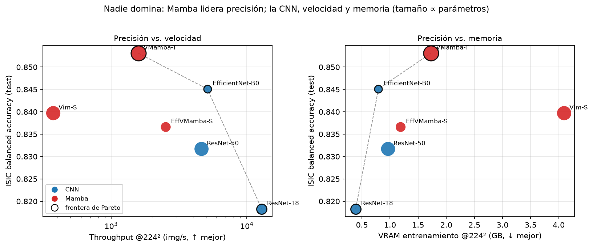

# Mamba vs. CNN — a controlled comparison for image classification

**Do State Space Models (Mamba) actually beat CNNs, once you compare them fairly?**

Most published comparisons pit Mamba against CNNs with different model sizes, training recipes
and datasets, so the differences they report may come from the setup rather than the
architecture. This repository contains a single, model-agnostic training and benchmarking
pipeline in which **six ImageNet-pretrained models, matched by parameter budget, are trained and
measured under identical conditions**, leaving the architecture as the only variable.

> Undergraduate thesis — *Modelos de Espacio de Estado para Clasificación de Imágenes: Estudio
> Comparativo entre Mamba y CNN* (B.Eng. Electronic Engineering, Universidad de Ibagué, Colombia,
> 2026). Author: **Sergio Daniel Monroy Homez** · Advisor: Ph.D. Manuel G. Forero ·
> Semillero de Investigación Lún.



## Key findings

On a balanced clinical skin-lesion task (ISIC-DICM-17K, malignant vs. benign, held-out test set
of 2,240 images):

1. **Accuracy — Mamba wins, narrowly.** VMamba-T reached the best balanced accuracy (0.853,
   MCC 0.707, AUROC 0.912), ahead of the best CNN (EfficientNet-B0, 0.845).
2. **Speed and memory — CNNs win, clearly.** At the same parameter tier, CNNs were 2–3× faster
   and used 1.5–3× less VRAM (ResNet-50: 4,636 img/s vs. VMamba-T: 1,587 img/s, bf16 @ 224²).
3. **Resolution scaling — no Mamba advantage.** Training VRAM grows sub-quadratically for *all*
   models (exponent ≈ 1.7–1.95). The flat Mamba (Vim-S) runs out of memory at 768², while
   hierarchical Mamba and CNNs reach 1024²: in SSMs, a hierarchical design is not optional for
   high resolution.
4. **Where Mamba's accuracy comes from.** The effective receptive field of VMamba-T is close to
   global (edge/centre ratio 0.97) versus local for ResNet-50 (0.74).

**Takeaway:** no family dominates both axes. The repository ends with a decision criterion per
application profile — maximum accuracy, maximum speed / minimum memory, or best balance.

| Model | Family | Params (M) | ISIC balanced acc. | Throughput (img/s) | Latency bs=1 (ms) | Train VRAM (GB) |
|---|---|---:|---:|---:|---:|---:|
| EfficientNet-B0 | CNN | 5.3 | 0.845 | 5,119 | 3.00 | 0.79 |
| ResNet-18 | CNN | 11.7 | 0.818 | 12,869 | 1.02 | 0.39 |
| EfficientVMamba-S | Mamba | 10.8 | 0.837 | 2,527 | 4.89 | 1.19 |
| ResNet-50 | CNN | 25.6 | 0.832 | 4,636 | 2.37 | 0.97 |
| Vim-S | Mamba | 26.0 | 0.840 | 375 | 12.59 | 4.10 |
| **VMamba-T** | Mamba | 29.5 | **0.853** | 1,587 | 8.52 | 1.73 |

Efficiency measured in bf16, batch 16, 3 repetitions, on an NVIDIA RTX 5000 Ada (32 GB).
Raw numbers: [`results/efficiency/`](results/efficiency/) and
[`results/classification/`](results/classification/).

## Experimental protocol (parity by construction)

- **One pipeline, many models.** The model is swapped via a YAML config; data loading,
  augmentation, optimiser, schedule, seed and metrics are shared code (`pipeline/`).
- **ImageNet-1k weights for all six models** (CNNs from `timm`, Mamba backbones from their
  official repositories), only the classification head is replaced.
- **Parameter-matched tiers:** light (~5–11 M) and base (~25–30 M).
- **Frozen, stratified 70/15/15 split** stored on disk and shared by every model
  ([`splits/`](splits/)).
- **Gate test:** every model had to pass Imagenette (all reached Top-1 > 0.95) before entering
  the clinical experiment. One planned model (VSSD, Mamba-2) was excluded because its public
  checkpoints did not reproduce.
- AMP bfloat16, AdamW, cosine schedule with warm-up, label smoothing 0.1, EMA, gradient
  clipping, a single checkpoint-selection metric (balanced accuracy).

## Repository layout

```
pipeline/
├── train.py              single entry point (model × dataset)
├── benchmark.py          params, FLOPs, VRAM, throughput and latency from 224² to 1024²
├── configs/              _base.yaml (shared protocol) + one override per model
├── data/                 Imagenette and ISIC loaders, frozen splits, transforms
├── models/registry.py    timm CNNs + wrappers around the official Mamba repos
├── engine/               trainer, metrics (MCC, AUROC, balanced acc., …), benchmark
└── analysis/             test evaluation, effective receptive field, Pareto and scaling plots
environment/              pinned requirements and conda environments
results/                  per-sample test predictions, training curves, benchmark CSVs
splits/                   frozen ISIC and Imagenette splits (image IDs only)
figures/                  figures used in the thesis
```

## Reproducing

```bash
conda env create -f environment/environment_tesis_v3.yml   # VMamba-T, EfficientVMamba-S, CNNs
# Vim-S needs its own env (mamba_ssm 1.1.1): environment/environment_vim_s.yml

# Mamba backbones are loaded from their official repositories, cloned into third_party/:
#   MzeroMiko/VMamba · hustvl/Vim · TerryPei/EfficientVMamba
# and their ImageNet checkpoints (see pipeline/configs/*.yaml).

python pipeline/train.py --config pipeline/configs/vmamba_t.yaml \
    --dataset isic --isic-root /path/to/isic17k --split-file splits/isic_split.json
python pipeline/benchmark.py --config pipeline/configs/vmamba_t.yaml
```

Datasets are not redistributed. ISIC-DICM-17K is available from the ISIC Archive
(DOI [10.34970/233480](https://doi.org/10.34970/233480)); Imagenette from fast.ai.

## Related work by the author

- S. D. Monroy, M. G. Forero. *Overcoming Spatial Context Loss in Vision Mamba: An Architectural
  Analysis of 2D to 1D Data Routing.* 20th Colombian Conference on Computing (20CCC), Cartagena,
  2026. Accepted for publication in Springer Nature proceedings. Code:
  [vision-mamba-spatial-context](https://github.com/GITHUB_USER/vision-mamba-spatial-context).
- S. D. Monroy, M. G. Forero. *Accuracy–Efficiency Trade-offs in CNN and Mamba-based Skin Lesion
  Classifiers.* 1st International Online Conference on Imaging (IOCIM 2026, MDPI) — accepted.

## Contact

Sergio Daniel Monroy Homez — monroyhomez@gmail.com

---

*Resumen en español:* comparación controlada entre seis modelos CNN y Mamba, emparejados por
número de parámetros y entrenados con el mismo protocolo. Mamba (VMamba-T) logra la mayor
exactitud en clasificación de lesiones cutáneas; las CNN son 2–3 veces más rápidas y usan menos
memoria. Ninguna familia domina ambos ejes.
